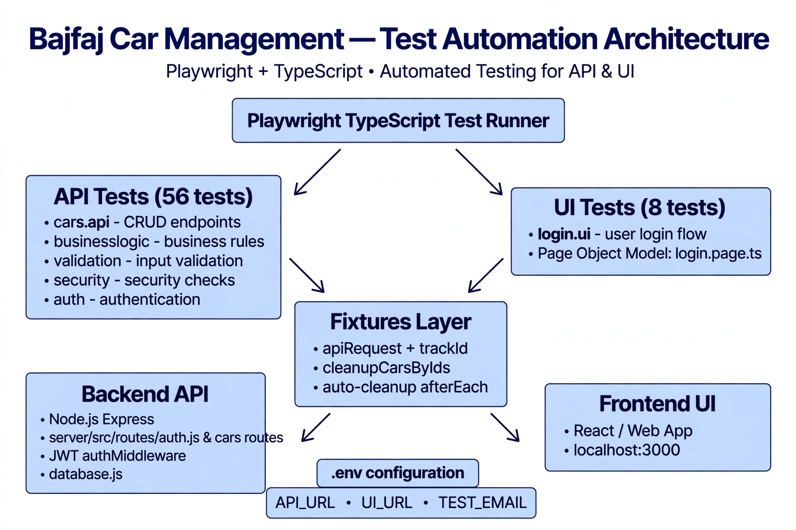

# Bajfaj Car Management - Test Automation
Playwright + TypeScript E2E test suite for bajfaj-car-management.

Covers full stack: API lifecycle + Business Logic + Validation + Security + UI Login. All tests isolated with auto-cleanup fixtures - no data leaks to dev/prod DB.



### Tech Stack
- Playwright Test (APIRequestContext + UI)
- TypeScript, dotenv, Page Object Model
- Isolated fixtures (`apiRequest` + `trackId`) + `cleanupCarsByIds`
- Auto-cleanup: tracks all created car IDs and deletes in `afterEach`

### Coverage - 64 Tests (All Passing) - Dev Env

**API - 56 tests** - `tests/api/`:

| File | What it covers | Count |
|---|---|---|
| `cars.api.spec.ts` | Health, CRUD lifecycle, profit calc, stats | 8 |
| `cars.businesslogic.api.spec.ts` | BL-01 to BL-06: profit calc, totalSpent, PUT/PATCH recalc | 6 |
| `cars.edgecases.api.spec.ts` | Empty payloads, invalid IDs, duplicate plates, boundaries | 5 |
| `cars.validation.api.spec.ts` | VAL-01 to VAL-14: negative fields, missing required, enum | 14 |
| `cars.security.api.spec.ts` | SQLi / XSS, auth guards, delete guard | 3 |
| `auth.api.spec.ts` + `auth.validation.api.spec.ts` | AUTH-01 to AUTH-19: login, trim, lowercase, logout blacklist | 20 |

**UI - 8 tests** - `tests/ui/`:

| File | What it covers |
|---|---|
| `login.ui.spec.ts` | LOGIN-01 to LOGIN-08: valid/invalid login, validation, logout clears session, Enter key submit |

POM: `tests/pages/login.page.ts` - centralizes selectors + actions

### Key Fixes Proven By This Suite
1. **PATCH stale profit** - Fixed in backend, profit now recalculates on every update
2. **BL-03 profit calc** - `makeCarPayload()` includes default fees, tests zero additionalFee/delivery/repair for determinism
3. **Auth email normalization** - `server/src/routes/auth.js` now `trim().toLowerCase()` before Zod validation - fixes AUTH-15/16/19
4. **Data leak** - `trackId(id)` ensures 100% cleanup, no more AB12... test plates left behind
5. **JWT protection** - All car routes now require Bearer token

### How to run

```bash
npm install
cp .env.example .env
# set in .env:
# API_URL=http://localhost:3002
# UI_URL=http://localhost:3000
# TEST_EMAIL=admin@bajfaj.com
# TEST_PASSWORD=...

# Run all 64 against dev
npm run test

# API only
npm run test:api:dev

# UI only
npm run test:ui:dev

# Report
npx playwright show-report